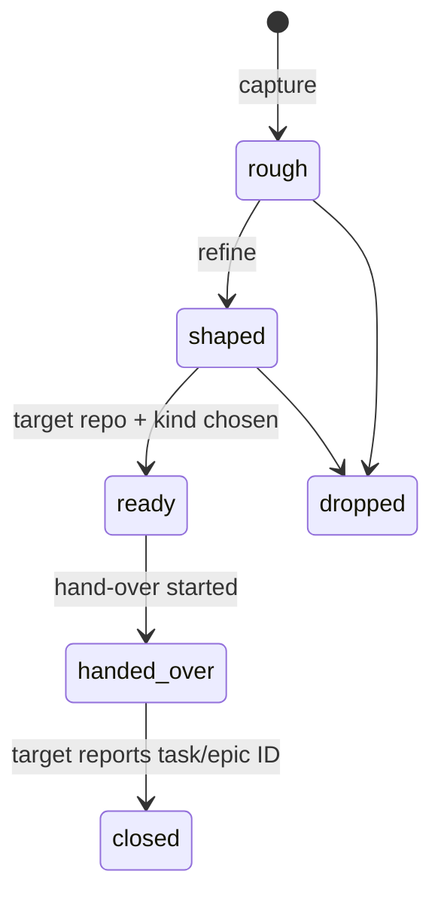

# PLAN — proposals

**Give a workspace one leader agent that keeps rough ideas as proposals and
hands a ready one to the target repo, which creates its own task from it.**

Started 2026-10-22, from a `dev-workspace` leader proposal. Task files: drafted
inline below until they stop moving. Durable design lives in `DESIGN.md`; this
file is only this effort.

Replaces most of [`mail`](../mail/PLAN.md), which is now `superseded`. Its
sibling effort [`dispatch`](../dispatch/PLAN.md) starts work on a task after
hand-over. Hand-over and work start are separate actions, and often only
hand-over happens. The [Overview](../dispatch/PLAN.md#overview) diagram in
`dispatch` shows both actions.

## Where I left off

_Rewritten wholesale by `/wrap` at the end of each session — state, not a log.
Never append a new dated entry; overwrite._

- **current task** — none; effort queued behind `dispatch`, which took the active
  slot on 2026-11-12. `dispatch` task `006` needs this effort's leader skill, so
  this one still has to land before `dispatch` can close.
- **next concrete step** — settle open question 1 (folder and template), then
  write `001`. Every other task reads or writes a proposal file.
- **files mid-edit** — none.
- **uncommitted / unpushed** — none.
- **open questions** — see **Open questions**. Questions 1 and 2 block `001`
  and `003`.

## Why

The user wants to work through **one leader agent** in the workspace root.
Today they open and drive a separate agent in each child repo by hand. They also
need a place to save half-formed ideas for a repo before those ideas are tasks.

`DESIGN.md` §8.7 records the gap: the workspace triage area sends work that
belongs to a child repo *to that child*, but provides no mechanism to send it.
`mail` was designed to fill that gap with peer-to-peer delivery. This effort
fills it with a single leader and a hand-over that the target repo performs
itself.

## Terms

| Term | Meaning |
|---|---|
| **proposal** | An idea for work in some repo, kept in the workspace until it is ready. Can be rough. |
| **leader** | The agent session rooted in the workspace. The only writer of proposals. |
| **hand-over** | The target repo accepts a ready proposal and creates its own task or epic from it. |
| **target repo** | The repo a proposal is for. Can be the workspace itself. |

## The workflow

1. **Capture.** The user tells the leader about an idea. The leader writes a
   proposal in the workspace. If the idea came up during work in a child repo,
   the leader can read that child's files and session transcript (read-only)
   for context.
2. **Shape.** The user and the leader refine the proposal over time.
3. **Hand-over.** When the user says so, the leader starts a short `claude -p`
   session rooted in the target repo's main checkout. That session creates a
   task or epic with the repo's own task scripts, commits it, and reports the
   ID. The proposal closes and records the ID. The task now owns the life
   cycle. Nothing syncs back.

### Proposal life cycle

The state names avoid `draft`, `inbox`, and `backlog`. The task system already
uses those words.

## Scope

**In:**

- A generator-owned proposal folder and template in every generated workspace,
  shipped through `update.sh` and tracked by the `.gitignore` allowlist.
- Leader verbs: capture, list, hand over. A workspace-only skill plus `make`
  targets.
- The `tasks` key in a child's `discovery.json`, so the leader can find a
  target's task scripts.
- The hand-over session: prompt, permissions, the reported ID, closing the
  proposal.
- Tests, and graduating the decisions into `DESIGN.md`.

**Out:**

- **Work start.** Worktrees, background sessions, status, and replies belong to
  [`dispatch`](../dispatch/PLAN.md).
- **Capture from a child repo.** Child repos cannot write proposals (decision 4).
- **Syncing task state back into the proposal.** After hand-over the task owns
  the life cycle. The only link is the ID in each direction.
- **The `inbox` key in `discovery.json`.** Nothing writes into a target from
  outside any more, so there is no intake to declare.
- **The leader committing in a child repo** (decision 6).

## Tasks

In build order. Tasks carried from `mail` keep a pointer to their old number;
`mail`'s plan records why each moved.

| # | Task | Status |
|---|---|---|
| 001 | proposal storage: folder, template, frontmatter, allowlist entry | todo |
| 002 | capture and list verbs | todo |
| 003 | the `tasks` key in `discovery.json` (from `mail` `008`, partly) | todo |
| 004 | the hand-over session | todo |
| 005 | generalize the skill install loop (from `mail` `005`) — may already be done by `rollups` `24` | todo |
| 006 | the leader skill | todo |
| 007 | acceptance tests (from `mail` `007`, rewritten) | todo |
| 008 | graduate the durable decisions into `DESIGN.md` (from `mail` `009`) | todo |

### 001 — proposal storage

A generator-owned folder in the workspace holds one file per proposal, created
from a template. Frontmatter carries:

- `target` — a repo name from `repos.yml`, or the workspace itself.
- `kind` — `task` or `epic`, the kind requested from the target.
- `state` — one of the life-cycle states above.
- `result` — the task or epic ID the target reported. Empty until `closed`.

The folder is **content**, not machinery, in the `DESIGN.md` §7.3 split:
`update.sh` creates it and owns the template, but never overwrites a proposal.
The `.gitignore` allowlist must track it. This is new generated machinery, so it
also falls under workspace task `229ccb-generator-versioning-and-update-signal`.

Acceptance: a fresh workspace and an updated workspace both have the folder and
template; `update.sh` leaves existing proposals byte-identical; the wrapper
tracks proposals in git.

### 002 — capture and list

Workspace-side verbs, for example `make proposal NAME=<slug> TARGET=<repo>` and
`make proposals`. Capture writes a `rough` proposal from the template. List
shows every proposal not `closed` or `dropped`, with target and state.

Capture validates `target` against `repos.yml`. A child repo cannot run these
verbs — they exist only in the wrapper.

Acceptance: capture refuses an unknown target; list is silent when nothing is
open; neither verb writes outside the proposal folder.

### 003 — the `tasks` key in `discovery.json`

Carried from `mail` `008`. The `inbox` key goes; the `tasks` key stays. It
declares where a repo's task system is mounted and which scripts create work, so
the hand-over prompt can name them instead of probing.

Still holds from `mail`: one shared `discovery.json` per repo, one key per
capability, a version per key, each generator owns its own keys, and the
leader reads the declaration live and never caches it in `repos.yml`.

`create-project-system` writes the key upstream (non-blocking — a hand-written
key works for the repos that matter now). `tools/revendor.sh` runs
`rm -rf "$DEST"`, so the change goes upstream or not at all. Read
`create-project-system` task `27` first; it states the same missing-declaration
problem from the consumer side.

Acceptance: the schema for `tasks` is written down; a repo with no
`discovery.json`, or no `tasks` key, is a defined state with a defined
hand-over behaviour (see open question 2).

### 004 — the hand-over session

`ready → handed_over` is manual: the user says "hand it over" (decision 8).
Then the leader:

1. Resolves the target's main checkout through `repos.yml`.
2. Reads the target's `tasks` declaration live.
3. Starts `claude -p` with the target as working directory, so the session
   loads the target's own `CLAUDE.md`, settings, hooks, and skills.
4. The session creates the task or epic with the target's own scripts, commits
   it under the target's commit schema, and prints the ID.
5. The leader records the ID in `result` and sets `state: closed`.

**The prompt must be self-contained.** The child session does not run where the
proposal lives, so the prompt carries the proposal body inline rather than a
path into the workspace. See the second-brain note
`resources/externalized-prompts-must-be-self-contained.md`.

**Why a session in the target, not a leader subagent.** A subagent from the
`Agent` tool runs inside the leader's process. It has the leader's settings and
hooks, and its shell returns to the leader's root after each command. A session
started in the target loads that repo's rules. Subagents stay useful for
read-only work such as capture.

**The workspace as target.** The workspace is a hand-over target like any other
repo (decision 3). Its task system is `.workspace/project/tasks/`. See open
question 5 for whether the leader starts a session for it or acts in-process.

Acceptance: a ready proposal becomes a committed task in the target with the
proposal's content; the proposal records the ID; the leader made no commit in
the target; a failed hand-over leaves the proposal `ready`, not `handed_over`
with no ID.

### 005 — generalize the skill install loop

Carried from `mail` `005`. `lib/generator.sh:160-178` installs only
`workspace-status`. It must not prune `.claude/skills/task-system/`, which the
vendored `create-project-system` owns.

**`rollups` task `24` needs the same change** for its `/whats-next` skill, and
`rollups` is active. If `24` lands first, this task reduces to checking that its
loop covers a third skill. If this task is reached first, do it here and point
`24` at it. Do it once.

Acceptance: two or more skills install and re-install with zero diff;
`task-system/` survives `update.sh`; a file deleted from a template skill is
pruned from the install.

### 006 — the leader skill

Source: `template/claude/skills/<name>/SKILL.md`. Installed into the workspace
only — never into a child repo. Replaces `mail`'s `send-mail` skill.

Follow the `workspace-status` precedent: a trigger-shaped `description`, and a
body that points at the verbs and the template rather than restating them. The
skill covers capture, shape, list, and hand-over. `dispatch` adds work start to
the same skill or a sibling — decide when `dispatch` opens.

Acceptance: the skill fires on "save an idea for repo X" and "hand over
proposal Y"; it restates neither the template nor the verb usage.

### 007 — acceptance tests

Carried from `mail` `007`, rewritten. Extend `tests/run-tests.sh`: a generated
workspace with two child repos, one declaring `tasks` and one not. Capture a
proposal; list it; refuse an unknown target; run hand-over against the declared
repo with the `claude -p` call replaced by a stub that runs the task script and
prints an ID; assert the proposal closed with that ID; assert the undeclared
repo gets the defined behaviour from `003`.

The real `claude -p` call stays out of the suite. The stub boundary is the
command line the leader builds, which the test asserts on.

### 008 — graduate to `DESIGN.md`

Carried from `mail` `009`. Per `docs/plans/README.md`, a decision left only in
a plan is one the next effort re-litigates. Candidates are under **Decisions**.
The transferable ones go to the second-brain as lessons, linking here as
evidence.

## Decisions

Settled by the user on 2026-10-22 unless marked. One line each: what was
chosen, what it rules out, why.

1. **The word is "proposal".** It fits a rough idea and a ready hand-over.
   Rejected: brief (an instruction, not an idea), spec (implies detail the idea
   lacks), RFC (implies outside review).
2. **Proposals live in the workspace,** not in the target repo. A rough idea is
   not yet the target's work, and it must not add noise to that repo's backlog.
3. **Every idea starts as a proposal,** including work for the workspace itself.
   The workspace is a hand-over target like any other repo. The triage area
   (`.workspace/project/tasks/`) then holds only accepted workspace tasks.
4. **Capture is workspace-only.** Child repos cannot write proposals. Child repos
   must not influence siblings. All proposals pass through the leader.
5. **Proposals and the task system are separate.** The task system records
   accepted work, owned by each repo. Proposals are workspace-side. The only
   link is a reference ID in each direction.
6. **The leader never commits or merges in a child repo.** Child sessions commit
   their own work. The hand-over session commits the task it creates.
7. **New workspace structure ships from this generator** through `update.sh`.
   Nobody adds folders or verbs to a generated workspace by hand.
8. **Hand-over is manual for now.** `ready → handed_over` is the user's last
   review before another repo takes ownership.
9. **Two efforts, not a rewrite of `mail`.** `proposals` then `dispatch`, queued
   after `rollups`. `mail` becomes `superseded` and keeps its plan as the record.
   *The ordering half was overtaken on 2026-11-12: the user promoted `dispatch`
   first, to drive `dogfood` `12` and `25`. The two-efforts split still holds;
   only the sequence changed. See `dispatch` decision 9.*
10. **Carried from `mail`, still holding:** work is addressed to repos, not
    agents; one shared `discovery.json` with one key per capability; the
    declaration is read live, never cached.
11. **Hand-over runs in a session rooted in the target, not a leader subagent**
    — so the target's own rules apply. (Proposal mechanics, adopted with the
    effort.)

## Open questions

Move each to **Decisions** once resolved, with the reasoning, rather than
deleting it. Numbers in brackets are the leader proposal's original numbers.

1. **[2] Which folder and file layout holds proposals, and what is the
   template?** For example `.workspace/proposals/<date>-<slug>.md`, or a visible
   top-level folder. Blocks `001`.
2. **[3] How does the leader find a target's task scripts?** A `tasks`
   declaration in `discovery.json`, or a fixed convention? What happens with a
   repo that has no task system — refuse the hand-over, or let the session
   write a plain file the repo's owner chooses? Blocks `003`.
3. **[5] What permission profile does the hand-over session get?** It must run
   task scripts and `git commit` with no one at the prompt. Child sessions do
   not run with bypass permissions. Candidates: `--allowedTools` scoped to the
   declared scripts and `git`, or a named permission mode. Shared with
   `dispatch`. **Partly settled** by `dispatch` decision 7 (2026-10-23): every
   child runs in the leader's mode, auto.
4. **[6] Can the leader read child transcripts safely and cheaply enough for
   capture?** Transcripts can be large. Reading a slice, or delegating to a
   read-only subagent, are candidates.
5. **Does hand-over to the workspace itself start a session?** The leader is
   already rooted there. Starting a `claude -p` keeps one code path; acting
   in-process is cheaper but makes the leader commit, which decision 6 forbids
   only for child repos.
6. **What happens when the target's main checkout is dirty or off its default
   branch?** The hand-over session commits there. Refuse, or commit only the
   task file and leave the rest?
7. **Which epic receives, when a target has several?** Carried from `mail`.
   `main` is the obvious default, but the declaration should name it.
8. **What happens to items already in `.workspace/project/tasks/`?** Decision 3
   says the triage area holds only accepted workspace tasks from now on. Do
   existing un-accepted ideas move into proposals, or stay as they are?

### CLI facts not yet checked

Read from `claude --help` on 2026-10-22 (installed version 2.1.309 on
2026-10-23). Check each one before `004` depends on it.

| Flag | Use | Unchecked |
|---|---|---|
| `-p` | One prompt, runs to the end, exits. Fits hand-over | Whether it loads the target's `CLAUDE.md`, hooks, and skills from the working directory exactly as an interactive session does |
| `--allowedTools`, permission modes | Non-interactive permissions | Which combination lets the session run task scripts and commit without bypass |

## Done when

From the workspace root, the leader captures a proposal for a child repo, lists
it, and hands it over on the user's word. The target repo then holds a
committed task created by its own scripts, the proposal records that task's ID
and reads `closed`, and the leader made no commit in the target. The suite
covers capture, list, hand-over, and the repo with no `tasks` declaration.

---

_On finishing: review every task file against `DESIGN.md`, graduate the durable
conclusions, slim this file to pointers, and leave it in `docs/plans/proposals/`._
